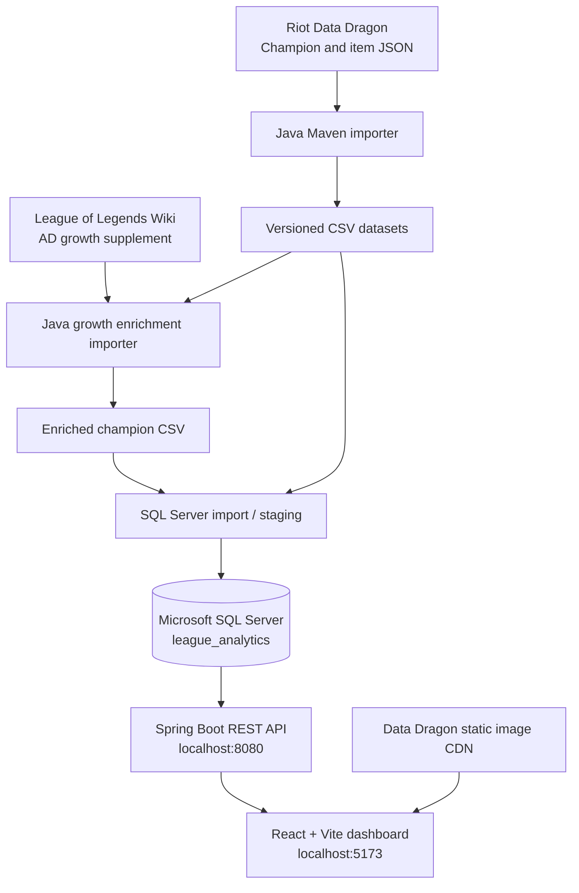

# Kazer0 League Analytics

**A full-stack League of Legends data analytics portfolio project** built with Java, Spring Boot, Microsoft SQL Server, and React.

Kazer0 League Analytics turns champion and item reference data into an interactive dashboard. It combines a Java-based data ingestion pipeline, relational storage, a read-only REST API, and a League-inspired frontend for exploring statistics, comparing items, and visualizing trends.

> **Project status:** Local development / portfolio preparation. Public deployment is planned, not yet documented as complete. Features described below reflect the implemented project roadmap; verify each feature against the current branch before publishing this README.

## Contents

- [Features](#features)
- [Tech stack](#tech-stack)
- [System architecture](#system-architecture)
- [Project structure](#project-structure)
- [Data sources and dataset](#data-sources-and-dataset)
- [Getting started](#getting-started)
- [Running the application](#running-the-application)
- [REST API reference](#rest-api-reference)
- [Analytics methodology](#analytics-methodology)
- [Testing and quality checks](#testing-and-quality-checks)
- [Troubleshooting](#troubleshooting)
- [Security and deployment](#security-and-deployment)
- [Roadmap](#roadmap)
- [Third-party assets and disclaimer](#third-party-assets-and-disclaimer)

## Features

### Dashboard and data exploration

- Overview of imported champion and item totals.
- **Champion Explorer:** search, filter by role, sort statistics, paginate results, and open individual champion profiles.
- **Champion Details:** view base and growth statistics, alongside estimated values by level; levels 19–20 are relevant to champions who complete the Top Lane role quest.
- **Item Explorer:** search, filter by recorded attributes, sort by cost or stats, and inspect individual equipment.
- **Item Details:** inspect recorded attributes, gold cost, sell price, recipe components, and extracted passive or special effects.
- **Item Comparison:** compare two items' stats and purchase costs side by side.

### Interactive analytics

- **Champion Rankings:** rank champions across base, growth, combat, defense, and movement statistics, in ascending or descending order.
- **Champion Level Progression:** inspect estimated stat progression across champion levels.
- **Champion Role Averages:** group champions by role, calculate mean values, and display the number of valid records contributing to each average.
- **Item Stat per 1,000 Gold:** rank items by a selected recorded stat divided by purchase cost, with minimum-price filters and adjustable result limits.
- League-inspired dark navy, gold, and teal design, with champion portraits, splash artwork, and item icons where available.

The frontend is an **analytics application**, not an official League of Legends client or a live match-tracking service.

## Tech stack

| Layer | Technology | Purpose |
| --- | --- | --- |
| Data ingestion | Java 21, Maven | Import, enrich, and validate game reference data |
| Data parsing | JSON handling, jsoup, Apache Commons CSV | Data Dragon, wiki HTML, and CSV processing |
| Database | Microsoft SQL Server | Relational storage of champions, items, recipes, and effects |
| Backend | Java 21, Spring Boot 4.1.1, Spring JDBC | Read-only REST API and stat calculations |
| Frontend | React, Vite, JavaScript | Interactive single-page dashboard |
| UI | React Router, Recharts, Lucide React, CSS | Navigation, charts, icons, and responsive layout |
| Testing | JUnit 5, Vitest | Backend calculation and frontend utility tests |
| Development environment | Windows / PowerShell | Local project workflow |

## System architecture



In development, React requests `/api/...` through Vite's proxy to the Spring Boot server. SQL Server is accessed by the backend, **not directly by the browser**.

### Database entities

| SQL Server table | Stores |
| --- | --- |
| `dbo.champions` | Champion identity, roles, resource type, base stats, and growth coefficients |
| `dbo.items` | Item identity, prices, recorded stats, descriptions, and source patch |
| `dbo.item_recipes` | Item-to-component build relationships |
| `dbo.item_effects` | Parsed item passive and special-effect descriptions |

Some components referenced in recipe data may not be present in the imported item list. The application represents these as unresolved references rather than inventing item records.

## Project structure

```text
league-analytics/
├── importer/                   # Java/Maven data extraction and enrichment
│   ├── pom.xml
│   └── src/main/java/com/kazer0/league/
│       └── ChampionAttackDamageGrowthImporter.java
├── datasets/
│   └── patch-26.20/           # Exported source and enriched CSVs
├── database/                   # SQL Server scripts / schema workflow
├── backend/
│   ├── pom.xml
│   └── src/
│       ├── main/java/com/kazer0/leagueapi/
│       │   ├── controller/
│       │   ├── model/
│       │   ├── repository/
│       │   └── service/
│       ├── main/resources/application.properties
│       └── test/java/com/kazer0/leagueapi/
└── frontend/
    ├── package.json
    ├── vite.config.js
    └── src/
        ├── components/
        ├── layouts/
        ├── pages/
        ├── services/
        ├── utils/
        ├── App.jsx
        └── App.css
```

The exact names and files in your working branch may differ as the project evolves.

## Data sources and dataset

### Riot Data Dragon

The primary dataset was imported from Riot's static Data Dragon assets for **patch 26.20** (Data Dragon version **`16.20.1`** in the local import workflow).

The working import has included approximately:

| Dataset | Imported records |
| --- | ---: |
| Champions | 173 |
| Items | 253 |
| Item recipe relationships | 409 |
| Item effect records | 242 |

These are counts from the project's import workflow, **not live server counts**. They may change with dataset updates, filters, or source revisions.

### Attack Damage Growth enrichment

The project includes a separate Java importer, `ChampionAttackDamageGrowthImporter`, for supplementing the `attack_damage_growth` CSV column using the [League of Legends Wiki attack damage table](https://wiki.leagueoflegends.com/en-us/List_of_champions/Attack_damage).

This enrichment is necessary because the Data Dragon `attackdamageperlevel` values used in the project may be missing or incorrect. The enrichment pipeline:

1. Retrieves wiki HTML or reads a saved local HTML snapshot.
2. Extracts champion names and AD growth coefficients.
3. Normalizes and matches champion names to existing CSV rows.
4. Validates the record count and match coverage.
5. Writes a **separate output CSV** so the source file is preserved.
6. Requires a subsequent SQL Server import/update before the dashboard reflects changes.

**Important:** The wiki is not automatically pinned to patch 26.20. The enrichment retrieval date and any discrepancies should be recorded when combining wiki values with patch-specific Data Dragon data. Do not assume every current wiki value is historically accurate for patch 26.20.

### Data limitations

- Missing statistics are represented as **missing**, not silently converted to zero.
- Champions can have multiple roles, so role-average groups overlap.
- Some recipe components or passive details may be absent or incomplete in source data.
- Item stat-per-gold ratios describe one recorded stat; they do **not** capture overall item power, active effects, or passive effects.
- Champion level calculations are estimates and may not model special champion mechanics. Values above level 18 must be validated against current in-game mechanics.

## Getting started

### Requirements

- **Java 21** (JDK)
- **Apache Maven** (the local setup uses Maven 3.9.16)
- **Node.js and npm** compatible with the frontend's installed Vite version
- **Microsoft SQL Server** and optionally SQL Server Management Studio (SSMS)
- PowerShell or another supported terminal
- Imported database tables and dataset files

### 1. Clone the repository

```powershell
git clone <YOUR_REPOSITORY_URL>
cd league-analytics
```

Replace `<YOUR_REPOSITORY_URL>` with the public GitHub URL after publishing your repository.

### 2. Prepare SQL Server

Create the `league_analytics` database, apply the project's SQL scripts, and import the versioned datasets. Populate the following tables before starting the API:

```text
dbo.champions
dbo.items
dbo.item_recipes
dbo.item_effects
```

Use a database administrator account for schema creation and data imports. The application itself should connect with a separate **read-only** SQL login such as `league_api_user`.

The backend is currently configured for SQL Server on `localhost:1433`. Confirm SQL Server is running, TCP/IP access is enabled, and the target database exists.

### 3. Configure backend environment variables

The Spring Boot configuration reads database credentials from environment variables; **never commit a real SQL Server password**.

In the **same PowerShell terminal** in which you will run Maven:

```powershell
$env:DB_USERNAME = "league_api_user"

$securePassword = Read-Host "SQL Server password" -AsSecureString
$env:DB_PASSWORD = [System.Net.NetworkCredential]::new(
    "",
    $securePassword
).Password
```

The local `backend/src/main/resources/application.properties` is expected to contain settings equivalent to:

```properties
spring.datasource.url=jdbc:sqlserver://localhost:1433;databaseName=league_analytics;encrypt=true;trustServerCertificate=true
spring.datasource.username=${DB_USERNAME}
spring.datasource.password=${DB_PASSWORD}
spring.datasource.driver-class-name=com.microsoft.sqlserver.jdbc.SQLServerDriver
```

`trustServerCertificate=true` is a **local-development convenience**. For public deployment, configure proper TLS verification and avoid exposing database credentials.

### 4. Install frontend dependencies

```powershell
cd frontend
npm install
```

## Running the application

Run the backend and frontend in **separate terminals**.

### Backend — Spring Boot

From the project root, after setting `DB_USERNAME` and `DB_PASSWORD` in that terminal:

```powershell
cd backend
mvn spring-boot:run
```

If Maven is not on your PATH, the Windows setup used during development runs:

```powershell
& "C:\Program Files\Apache\Maven\apache-maven-3.9.16\bin\mvn.cmd" spring-boot:run
```

API base URL: `http://localhost:8080`

### Frontend — React + Vite

```powershell
cd frontend
npm run dev
```

Local dashboard: `http://localhost:5173`

The development proxy forwards `/api` requests to Spring Boot on port `8080`.

### Regenerating the champion AD growth CSV

From `importer/`, compile and run the enrichment importer:

```powershell
mvn clean compile
mvn exec:java `
  "-Dexec.mainClass=com.kazer0.league.ChampionAttackDamageGrowthImporter" `
  "-Dexec.args=../datasets/patch-26.20/champions.csv ../datasets/patch-26.20/champions_with_ad_growth.csv"
```

Notes:

- The output CSV must **not already exist** unless your importer has been modified to allow overwriting.
- The importer refuses input and output paths that are identical.
- If direct wiki downloading fails, the importer can accept a saved HTML file as a third argument.
- Running the original Data Dragon importer may overwrite source CSV exports; keep a copy of the enriched data or integrate enrichment into the pipeline.
- **A new CSV does not update SQL Server automatically.** Verify it, then use your SQL import/staging process to update `dbo.champions.attack_damage_growth` by champion ID.

## REST API reference

All routes below are relative to `http://localhost:8080`.

### Health and counts

| Method | Endpoint | Description |
| --- | --- | --- |
| `GET` | `/api/health` | API health check |
| `GET` | `/api/champions/count` | Champion total |
| `GET` | `/api/items/count` | Item total |

### Champions

| Method | Endpoint | Description |
| --- | --- | --- |
| `GET` | `/api/champions` | All imported champions |
| `GET` | `/api/champions/{id}` | Champion by numeric ID |
| `GET` | `/api/champions/search?name=Ahri` | Search by name |

### Items

| Method | Endpoint | Description |
| --- | --- | --- |
| `GET` | `/api/items` | All imported items |
| `GET` | `/api/items/{id}` | Item by numeric ID |
| `GET` | `/api/items/search?name=Trinity` | Search by name |
| `GET` | `/api/items/{id}/recipes` | Item recipe components |
| `GET` | `/api/items/{id}/effects` | Extracted item effects |

### Analytics

| Method | Endpoint | Description |
| --- | --- | --- |
| `GET` | `/api/analytics/champions/top-health?limit=10` | Rank by base health |
| `GET` | `/api/analytics/champions/top-armor?limit=10` | Rank by base armor |
| `GET` | `/api/analytics/champions/{id}/level/{level}` | Estimated champion stats at a level |
| `GET` | `/api/analytics/items/compare?ids=3078,3031` | Compare two items and their gold costs |

The frontend also calculates some rankings and averages from the `/api/champions` and `/api/items` responses. Those are **client-side analyses**, not separate API endpoints.

Example requests:

```powershell
Invoke-RestMethod http://localhost:8080/api/champions/count
Invoke-RestMethod http://localhost:8080/api/champions/103
Invoke-RestMethod http://localhost:8080/api/items/3078
Invoke-RestMethod 'http://localhost:8080/api/analytics/items/compare?ids=3078,3031'
```

## Analytics methodology

### Champion level growth

The project's standard estimate is:

\[
\operatorname{Stat}(L) = B + G(L-1)\left(0.7025 + 0.0175(L-1)\right)
\]

Where:

- `B` is the base statistic.
- `G` is the growth coefficient.
- `L` is the selected level.

This formula is used for supported growth-based attributes. It is **not a guarantee of exact in-game values** for all champions, and extension to levels 19–20 should be treated as extrapolation pending validation. The additional level cap is associated with the completed Top Lane role quest, not an inherent champion class.

### Champion role averages

\[
\operatorname{Mean}_{role,stat}=\frac{\sum_{i=1}^{n}x_i}{n}
\]

Only champions with a recorded numeric value for the selected statistic contribute to that statistic's average. The chart shows the associated sample size. A multi-role champion can appear in more than one group.

### Item stat per 1,000 gold

\[
\operatorname{Ratio} = \frac{\text{Recorded Item Stat}}{\text{Item Gold Cost}}\times1000
\]

Items with missing or nonpositive selected stat values, or nonpositive purchase costs, are excluded. This is a **single-stat ratio**, not a comprehensive valuation of an item's passives, actives, or gameplay utility.

### Rankings

Champion rankings filter out missing values, keep legitimate recorded zeros, and sort ascending or descending. The available number of results depends on the selected statistic's data coverage.

## Testing and quality checks

### Backend unit tests

```powershell
cd backend
mvn test
```

A focused calculator run:

```powershell
mvn "-Dtest=ChampionStatCalculatorTest" test
```

Tests cover the growth-calculation logic and supported level validation. Keep expectations synchronized with the implemented formula when expanding the allowed level range.

### Frontend tests and build

```powershell
cd frontend
npm test
npm run lint
npm run build
```

The frontend utility tests cover stat-per-1,000-gold arithmetic, including missing and invalid inputs. The `lint` command depends on your current `package.json` scripts.

### Manual checks

- Verify counts and search results against SQL Server.
- Open champion and item detail pages.
- Check both valid and nonexistent resource IDs.
- Compare item recipes, effects, and costs.
- Verify role averages, displayed sample sizes, and ranking order.
- Confirm champion and item images load, or show usable fallbacks.
- Test narrow layouts and keyboard navigation.
- Confirm the application handles an unavailable API with a helpful error message.

## Troubleshooting

| Symptom | Likely cause / check |
| --- | --- |
| `Login failed for user '${DB_USERNAME}'` | Set `DB_USERNAME` and `DB_PASSWORD` **in the terminal running Maven**. |
| Spring Boot cannot connect to SQL Server | Confirm SQL Server is running and reachable on port `1433`; verify credentials and database name. |
| React API requests fail | Ensure the backend is running on `8080` and the Vite `/api` proxy is configured. |
| `Cannot read properties of undefined` after API request | Confirm `fetchData()` ends with `return response.json();`. |
| AD growth remains missing in the UI | Verify enriched CSV → SQL Server update → repository mapping → `/api/champions/{id}` response. |
| `Invalid object name 'dbo.champions_growth_stage'` | Create/import the staging table in `league_analytics`, or use the actual imported schema and table name. |
| Growth enrichment runs the original importer | Run the correct Maven main class: `com.kazer0.league.ChampionAttackDamageGrowthImporter`. |
| Wiki HTML parsing fails | Save the wiki as HTML, inspect its table structure, and retry with the optional local-file argument. |
| Images do not load | Check Data Dragon version, asset ID mapping, browser network errors, and CDN availability. |

## Security and deployment

The project is currently set up for **local development**. Before a public release:

- Host the frontend and backend on appropriate services.
- Provision an accessible production database or deliberately migrate the dataset to a supported hosted database.
- Use environment variables or a secret manager for credentials.
- Limit application database permissions to the reads it needs.
- Replace local-development TLS settings with certificate verification.
- Configure production CORS / reverse-proxy behavior and environment-specific URLs.
- Add monitoring, error logging, and automated build checks.
- Review data and asset redistribution requirements and Riot's third-party developer policies.

Do **not** expose your local SQL Server port, credentials, or development machine to the public internet as a shortcut to deployment.

## Roadmap

- [x] Java-based data ingestion and CSV exports
- [x] SQL Server data model and Spring Boot REST API
- [x] React dashboard with champion and item exploration
- [x] Champion rankings, role averages, and level progression
- [x] Item details, comparison, and stat-per-gold analysis
- [x] Initial League-inspired visual direction and asset components
- [ ] Verify and complete all AD-growth enrichment/database updates
- [ ] Finish cross-browser accessibility and responsive QA
- [ ] Add screenshots and/or GIFs to this README
- [ ] Deploy the frontend, backend, and production dataset
- [ ] Add a live-demo link to the personal portfolio

### Future companion project: player match tracker

A separately planned application would use an installed **local Java collector** and **React dashboard** for a small, consenting sample of players. Its purpose is collecting played-match data for later analysis. **That collector is not part of the current champion/item reference-data platform.**

## Third-party assets and disclaimer

This project uses League of Legends reference data and may display images from Riot's Data Dragon static asset service. League of Legends and Riot Games are the property of Riot Games, Inc. This is an independent educational/portfolio project.

**Riot disclaimer:**

> Kazer0 Analytics isn't endorsed by Riot Games and doesn't reflect the views or opinions of Riot Games or anyone officially involved in producing or managing Riot Games properties. Riot Games, and all associated properties are trademarks or registered trademarks of Riot Games, Inc.

Source references:

- [Riot Developer Portal](https://developer.riotgames.com/)
- [Riot Data Dragon documentation](https://developer.riotgames.com/docs/lol#data-dragon)
- [League of Legends Wiki: Attack Damage](https://wiki.leagueoflegends.com/en-us/List_of_champions/Attack_damage)

Before publishing, review the current Riot developer policies and confirm that your app's branding, asset use, and registration (if applicable) comply.

---

**Created by Kazer0** · Java · Spring Boot · SQL Server · React · Data Analytics
